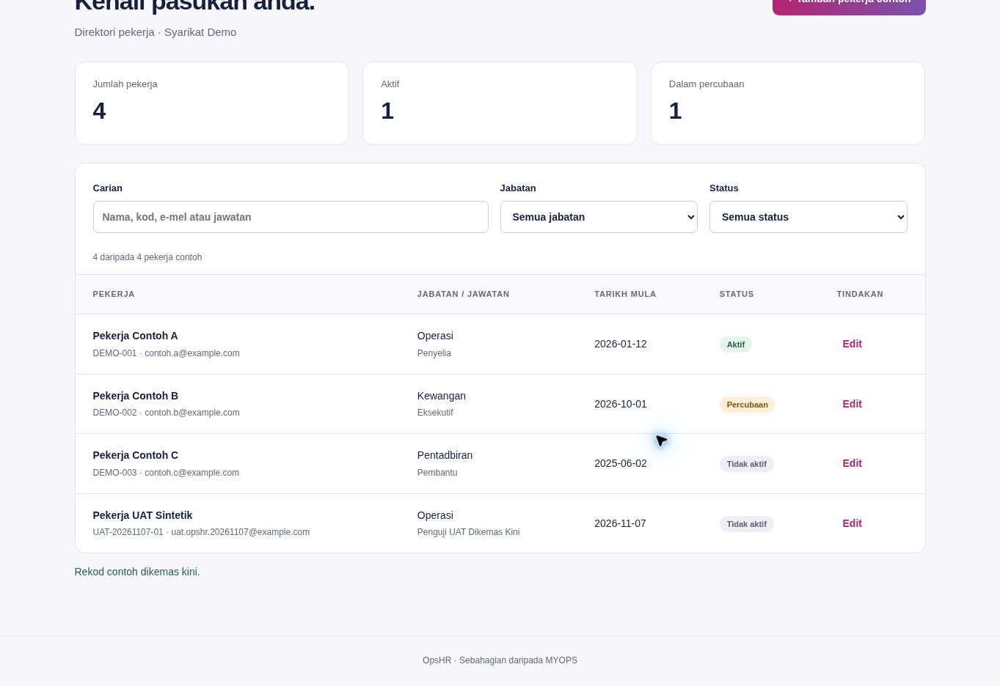
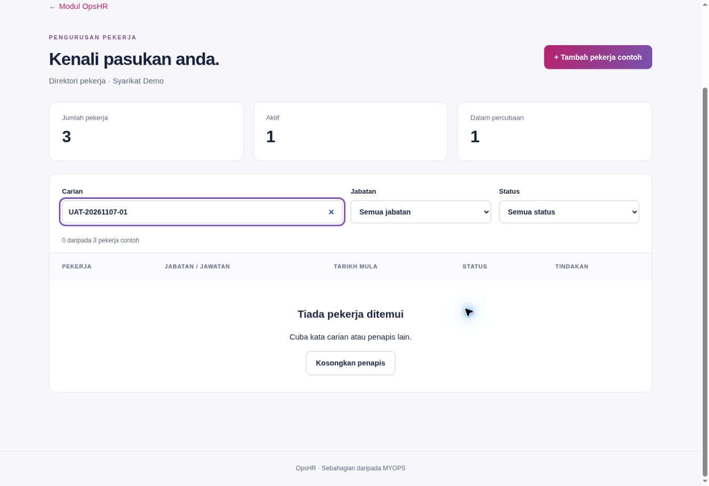

# OpsHR live URL UAT — 7 November 2026 (Malaysia)

**Overall result: FAIL. Full functional V1 UAT is BLOCKED.**

The requested stable live URL was tested directly through an actual browser and authorized Vercel HTTP access. This is separate from the newer Preview where database connectivity passes.

## Exact target

- Tested URL: https://opshr-mohd-syaiful-nizam1.vercel.app/
- Vercel deployment: `dpl_7e1X6SJujx3kYSPaqmieHeT1FCCQ`, READY.
- Deployed code: https://github.com/niz262025-hub/OPSHR/commit/59d6f94799fb84365174490e30cabbbc016a214f
- Vercel identifies this alias target as **staging**, not production. It still serves the older demo revision. No production release was inferred from the hostname.
- Latest verified DB-connected Preview code: https://github.com/niz262025-hub/OPSHR/commit/cc614a2a459864c2183ad123c54512643178aafa
- Latest verified DB-connected Preview: https://opshr-drvcl5aot-mohd-syaiful-nizam1.vercel.app
- PR: https://github.com/niz262025-hub/OPSHR/pull/22 (draft; not release-ready).

## Executed browser tests

| ID | Check | Status | Observed result |
| --- | --- | --- | --- |
| LIVE-01 | Homepage opens | PASS | HTTP 200 and actual browser rendering confirmed |
| LIVE-02 | Approved dashboard version | FAIL | Old marketing hero 'Urus pasukan anda, dalam satu tempat.' still visible; approved app sidebar/Quick Access dashboard is not deployed to this alias |
| LIVE-03 | Employee create UI | PASS | Added only synthetic `UAT-20261107-01`, name `Pekerja UAT Sintetik`; employee count increased from 3 to 4. This is in-memory UI behavior only |
| LIVE-04 | Employee edit UI | PASS | Changed the synthetic employee's designation to `Penguji UAT Dikemas Kini`; updated value appeared in the table |
| LIVE-05 | Employee deactivate UI | PASS | Changed only synthetic employee status to `Tidak aktif`; active count decreased from 2 to 1 |
| LIVE-06 | Employee persistence | FAIL | Reload returned count to 3; searching the new unique code returned 0 of 3 and 'Tiada pekerja ditemui'. Saved employee, edit and deactivate state were lost |
| LIVE-07 | Search/empty state | PASS | Search for the absent UAT code produced the expected empty state; this does not establish database filtering |
| LIVE-08 | Duplicate code rejection | PASS | Attempt to add existing code `DEMO-001` displayed 'Kod pekerja sudah digunakan.'; the attempt was cancelled without adding a row |
| LIVE-09 | Attendance workflow | BLOCKED | Actual page is read-only synthetic rows and explicitly has no punch-in or persistence |
| LIVE-10 | Leave workflow and balances | BLOCKED | Page explicitly says applications, approvals and real balances are unavailable; no approval action exists |
| LIVE-11 | Demo payroll arithmetic | PASS | Displayed RM3,500 + RM250 - RM120 = RM3,630; RM4,200 + RM180 - RM150 = RM4,230. These are synthetic sample lines only |
| LIVE-12 | Payroll approval/payslip permissions/duplicate processing | BLOCKED | Page explicitly says payroll approval, payslips and payments are not implemented; no actionable workflow to execute |
| LIVE-13 | Private documents upload/download | BLOCKED | Page contains metadata only and explicitly says no real uploads/files/private storage/access controls |
| LIVE-14 | Reports display arithmetic | PASS | Synthetic net payroll total RM7,860 matches the two sample net lines |
| LIVE-15 | Organization-filtered reports/export | BLOCKED | Page explicitly says there is no real data, export or MYOPS integration |
| LIVE-16 | Employee self-service | BLOCKED | Own leave, payslip, attendance and HR request actions show 'belum aktif'; page explicitly says identity/database/RLS are not connected |
| LIVE-17 | Central MYOPS launch | FAIL | `/launch` returns HTTP 404; no end-to-end central launch can be completed on this deployed revision |
| LIVE-18 | Subscription, company isolation, revocation and idle logout | BLOCKED | No verified central account/organization session or active persistent app workflow; do not mark helper/unit tests as live results |
| LIVE-19 | Current database health route on stable URL | FAIL | `/api/health/staging-config` returns HTTP 404 on the old deployment. This is not a failed DB password test |
| LIVE-20 | Desktop/browser smoke | PASS | Actual desktop browser loaded all tested pages and allowed demo employee interactions; this is not complete cross-browser/responsiveness acceptance |
| LIVE-21 | Mobile responsiveness | BLOCKED | No mobile viewport/device test executed in this live session |

The GET request to `/api/hr/staff-access` returned 405 (method not allowed). This is a GET method check only; it does not establish authenticated POST approval behavior.

## HTTP route checks

`/`, `/employees`, `/attendance`, `/leave`, `/payroll`, `/documents`, `/reports`, `/staff` returned HTTP 200. `/launch` and `/api/health/staging-config` returned 404. Successful rendering is not a functional V1 PASS.

## Evidence

Before refresh: the newly added employee had been edited and deactivated, and count was 4.

After refresh: count returned to 3, and the unique UAT employee code was absent.

## Cleanup and safety

Only clearly synthetic information with reserved example.com email addresses was entered. No real employees, production business data, subscription state, MYOPS authentication, database schema, database password, Vercel environment/protection, domain alias or production deployment was changed. The added record disappeared on reload; the duplicate test was cancelled. Baseline count was restored to 3. Screenshots contain only demo and synthetic records.

## Required before full live UAT can pass

1. Complete the reviewed MYOPS OpsHR controlled-UAT integration and trusted organization/role context; the prior owner approval gate remains outstanding.
2. Implement persistent tenant-scoped CRUD and complete the remaining V1 workflows against the approved isolated staging database. Validate authorization and negative isolation tests first.
3. Deploy the approved tested revision to the agreed protected Live UAT endpoint. Record exact alias target, environment, commit and rollback baseline. The current stable URL is on the old demo build; moving it alone will not complete V1.
4. Rerun these exact live checks, including persistent CRUD, leave approvals, payroll and own payslip authorization, private documents, company isolation, central logout/revocation/15-minute inactivity and mobile checks.

No public release or passing full UAT report is authorized by these results.
