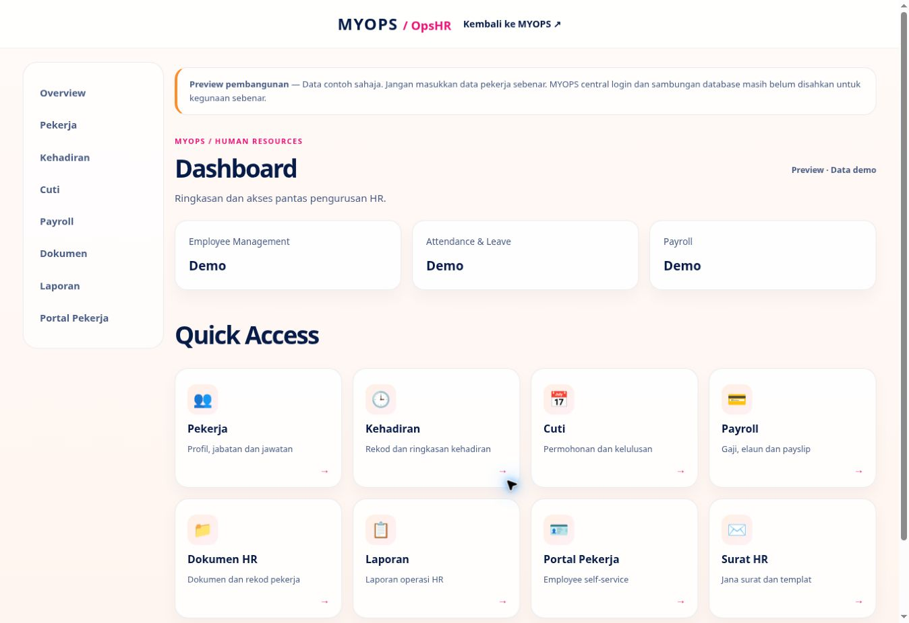

# OpsHR controlled Live UAT web deployment — 7 November 2026

**Deployment result: PASS. Full V1 functional UAT remains incomplete.**

The owner explicitly requested deployment to the live web URL after reviewing the failed UAT of the old demo. The stable endpoint now serves the current protected, staging-backed revision. This is a controlled UAT alias assignment, not a promotion to Vercel Production or a public customer release.

## Deployed target

| Field | Verified value |
| --- | --- |
| Stable Live UAT URL | https://opshr-mohd-syaiful-nizam1.vercel.app/ |
| Vercel project | `prj_fTbCr8Ez7cK3kEbh24kKxrcqPZ2z` / `opshr` |
| Team | `team_Bj103B4XwT91Y7BENjMuFQkn` |
| New deployment | `dpl_7hQd2k5G6pfZ5cyk8hCY89Vq4zsc`, READY |
| Build URL | https://opshr-d936svnjt-mohd-syaiful-nizam1.vercel.app |
| Exact deployed commit | https://github.com/niz262025-hub/OPSHR/commit/0b59db478ee26f20bbd690106635eca10d63e5f7 |
| Deployment environment | Preview using approved isolated staging database; stable UAT alias assigned to that tested build |
| Old deployment | `dpl_7e1X6SJujx3kYSPaqmieHeT1FCCQ` |
| Old commit | `59d6f94799fb84365174490e30cabbbc016a214f` |
| Existing access protection | Vercel SSO enabled for **all** deployments, verified after assignment; unchanged |
| Database target | Existing approved `ojamkplflqafedmxbdxb`, private `opshr_stage` schema, restricted `opshr_stage_app` role |

## Post-deployment verification

| Check | Status | Evidence / limit |
| --- | --- | --- |
| Stable alias resolves to intended build | PASS | Vercel alias lookup returned new deployment ID |
| Homepage HTTP | PASS | Actual stable URL returns 200 with new deployment assets |
| Approved dashboard | PASS | Real browser shows Dashboard, left navigation and Quick Access; old marketing hero absent |
| Runtime DB connectivity | PASS | Stable URL `/api/health/staging-config` returns HTTP 200, `configuration=ready`, `databaseConnection=connected` |
| Restricted role and schema probe | PASS | The same health query verifies expected role, no superuser/bypass-RLS and `opshr_stage` existence |
| Page availability | PASS | `/employees`, `/attendance`, `/leave`, `/payroll`, `/documents`, `/reports`, `/staff`, `/letters` return HTTP 200 |
| Error-log scan | PASS | No error/fatal log groups returned for this deployment over the checked recent 15-minute window; not a guarantee of zero future errors |
| Prior code validation | PASS | Code unchanged from the earlier validated revision: 68/68 tests, typecheck and build passed; later commits contain documentation/evidence |
| Central application authorization | BLOCKED | Health explicitly returns `applicationAuthorization=not_verified`; central OpsHR integration approval remains pending |
| Full V1 CRUD/approval/payslip/document/report/ESS UAT | BLOCKED | Deployment does not implement the missing persistent workflows. Rendering and DB connectivity are not a full module PASS |
| Mobile UAT | BLOCKED | No mobile device/viewport acceptance test performed in this deployment step |
| Public customer release | BLOCKED | No public release approval or change to catalog/app-client access was performed |
| Rollback | BLOCKED | Exact baseline and instructions recorded below; rollback was not exercised |

## Browser evidence

The old live UAT report is historical evidence for the old deployed commit. Its dashboard/version and missing-health-route failures are superseded by this deployment. The missing central authorization and persistent V1 workflows remain open; no claim is made that earlier employee persistence failure is fixed.

## Rollback instructions

Restore only the stable alias `opshr-mohd-syaiful-nizam1.vercel.app` to `dpl_7e1X6SJujx3kYSPaqmieHeT1FCCQ` using Vercel's assign-alias operation under the same team. Verify the alias lookup, homepage and unchanged SSO protection. The prior build is the known older demo with no working current health route, so use rollback only for a confirmed regression and preserve this limitation in the incident record.

No database down migration, credential change, central-auth modification or production-data rollback is required: this deployment step changed only one OpsHR UAT alias. Do not modify other app aliases or broaden access protection. The deployed code and database target remain immutable during this operation.

## Remaining release gates

Complete the approved MYOPS identity/organization/subscription integration, persistent tenant-scoped V1 modules and isolation tests. Run controlled full live UAT including session expiry/revocation, employee persistence, leave approvals, payroll approval/duplicate protection and own payslip access, private documents and exports, then request final public launch approval.
